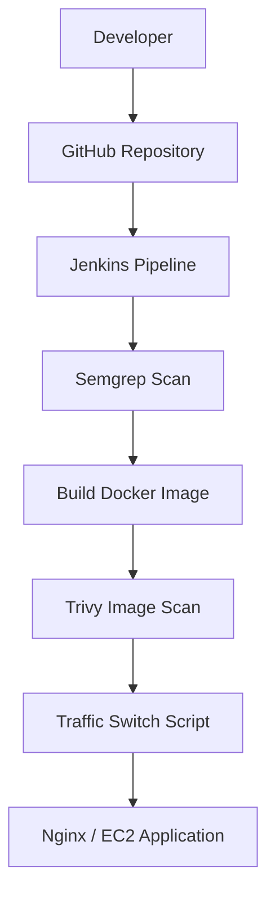
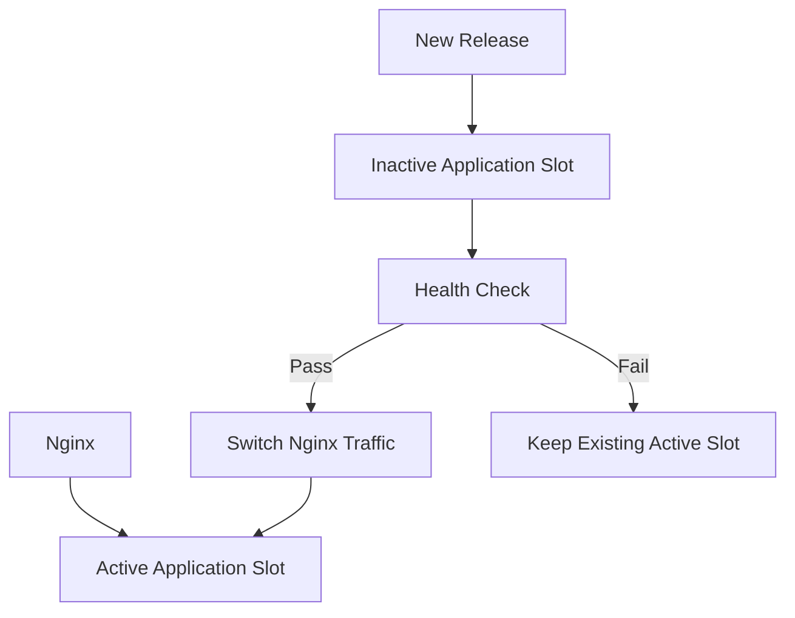

# NovaPay Digital Bank — CI/CD Project

## 1. Project Overview

NovaPay is an educational digital banking web application used to demonstrate DevOps practices, CI/CD automation, containerization, security scanning, and cloud deployment.

The project uses Jenkins, Git, Docker, Semgrep, Trivy, Amazon ECR, AWS EC2, and Nginx. Kubernetes manifests are included, but a running Kubernetes deployment has not been verified.

## 2. Project Objectives

- Manage source code using Git and GitHub.
- Automate pipeline tasks using Jenkins.
- Build Docker container images.
- Scan source code using Semgrep.
- Scan container images using Trivy.
- Document Amazon ECR image storage.
- Demonstrate EC2 deployment and Nginx traffic switching.
- Document architecture, testing, and rollback procedures.

## 3. Technologies Used

| Technology | Purpose |
|---|---|
| Git and GitHub | Source control |
| Jenkins | CI/CD pipeline automation |
| Docker | Container image builds |
| Semgrep | Source-code security scanning |
| Trivy | Container image scanning |
| Amazon ECR | Container image registry |
| AWS EC2 | Cloud server |
| Nginx | Web traffic routing |
| Linux and Bash | Server administration |
| Kubernetes YAML | Example deployment and service manifests |

## 4. Current Jenkins Pipeline

The current Jenkinsfile contains these stages:

1. Checkout source code.
2. Run Semgrep source-code scanning.
3. Build the Docker image `novapay-app:${BUILD_NUMBER}`.
4. Run a Trivy image scan for CRITICAL and HIGH severity findings.
5. Run the `novapay-switch` script to select the configured deployment slot.

**Security note:** The Trivy command uses `--exit-code 0`, so findings from this scan alone will not fail the build.

The current Jenkinsfile does not itself show an Amazon ECR push or an application health-check stage. Verify those operations separately before describing them as automated pipeline stages.

## 5. Architecture Diagram



## 6. Blue-Green Deployment Concept

The documented design uses active and inactive application slots. Verify the server configuration before relying on the ports or rollback procedure.



## 7. Application Verification

Check the HTTP response from the EC2 server:

```bash
curl -I http://127.0.0.1/
```

## 8. Kubernetes Manifests

Kubernetes Deployment and Service manifests are included under `pipeline/kubernetes/`, but a running Kubernetes cluster has not been verified.

## 9. Project Status

This project documents CI/CD configuration, Docker image building, security scanning, and deployment concepts. Verify ECR publishing, health checks, deployment, and rollback in Jenkins logs and server checks before reporting them as successful.
