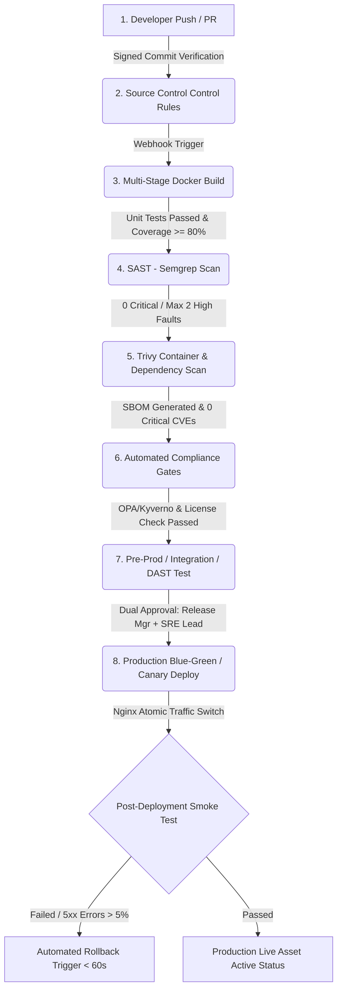

# NovaPay Digital Bank - CI/CD Pipeline Architecture Spec

This document details the production-grade, compliance-gated CI/CD pipeline architecture designed for NovaPay Digital Bank to reduce MTTR under 15 minutes and meet RBI Master Direction and PCI-DSS v4.0 regulations.

## Pipeline Architecture Diagram

## The 8 Canonical Pipeline Stages Specification

| Stage | Tooling | Quality Gates & Automation Thresholds | RBI / PCI-DSS Control Mapping |
| :--- | :--- | :--- | :--- |
| **1. Source Control** | GitHub Enterprise | Signed commits mandatory (GPG/SSH). Direct pushes to main blocked. | **RBI Sec 4.3:** Segregation of Duties **PCI-DSS Req 6.5** |
| **2. Build & Test** | Gradle / Java 21 | Mandatory unit testing with minimum line coverage >= 80%. | **RBI Sec 4.2:** Regulated Change Management |
| **3. SAST Scan** | Semgrep / SonarQube | **Zero Critical Vulnerabilities** allowed. Maximum 2 High issues. | **PCI-DSS Req 6.2:** Bespoke Software Security |
| **4. Dependency Scan**| Trivy | Complete SBOM generation in CycloneDX format. 0 Critical CVEs. | **RBI Sec 7.2:** Third-Party Supply Chain Risk |
| **5. Integration Test**| Pact / Ephemeral Env | API backward compatibility validation checks. | **RBI Sec 4.2:** End-to-end Verification |
| **6. DAST Scanning** | OWASP ZAP | Runtime vulnerability validation against OWASP Top 10 parameters. | **PCI-DSS Req 6.4 & 11.3:** Public App Protection |
| **7. Policy Enforcement**| OPA (Open Policy Agent)| Verification of image provenance checks (Cosign signature validation). | **RBI Sec 5.4:** Automated Encryption Verification |
| **8. Deployment & Verif**| Nginx Switch Script | Active/Inactive deployment targets. Auto-rollback triggered if 5xx errors > 5%. | **RBI Sec 6.1 & 6.3:** Immutable Logs & Incident Playbooks |

## Pipeline Parallelization & Velocity Matrix
* **Target Velocity:** Commit-to-production under **2 hours**.
* **Parallel Opportunities:** SAST scans (`Semgrep`) and dependency checks (`Trivy`) run simultaneously right after the primary compilation step completes to minimize developer friction feedback loop under 10 minutes.
