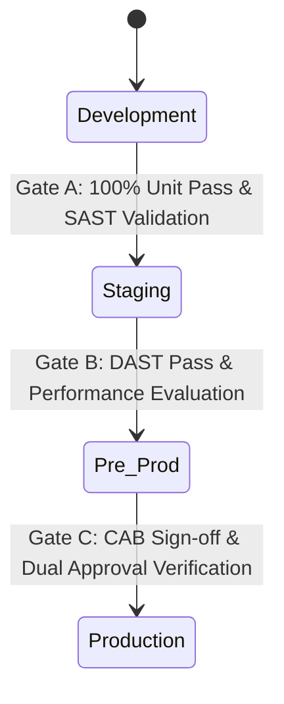

# NovaPay Digital Bank - Environment Promotion Workflow Specification

This document details the environment promotion matrix, strict quality gates, and configuration management strategy required to maintain structural parity across all environments while enforcing zero-trust data boundaries.

---

## 1. Four-Environment Promotion Topology Matrix

NovaPay strictly enforces an immutable deployment methodology: **"Same binary artifact, separate runtime configurations."** The exact same container image hash generated at the initial build phase must be promoted across all stages.

| Environment | Purpose & Evaluation Goals | Data Profile Matrix | Access Control Restrictions | Trigger Event |
| :--- | :--- | :--- | :--- | :--- |
| **Development** | Unit testing, structural validation, and execution debugging. | 100% Synthetic and mock-generated data sets. | Full access granted to Engineering teams. | Automated hook triggered on Pull Request creation/merge. |
| **Staging** | Dynamic evaluation (DAST), integration checking, contract verification. | Anonymized data profiles mimicking production loads. | Restricted to Dev, QA, and Automation engines. | Automated execution upon successful Dev stage validation. |
| **Pre-Production** | User Acceptance Testing (UAT), Technology Risk verification. | Masked production database records (PII scrubbing enforced). | Restricted to QA Leads, DBAs, and Security Officers. | Manual authorization token required following Staging validation. |
| **Production** | Live, customer-facing banking platform transactions. | Real-time active financial data streams. | Restricted exclusively to SRE Engineers and Release Managers. | **Dual Approval Gate Required:** Release Manager + SRE Lead validation. |

---

## 2. Hard-Blocking Promotion Gates Framework

### Transition Gate Requirements

#### A. Development ➔ Staging (100% Automated Execution)
* **Unit Tests:** 100% execution pass rate with zero tolerated exceptions.
* **Code Coverage:** Line coverage must meet or exceed **80%**; branch coverage must meet or exceed **70%**.
* **Static Analysis (SAST):** Zero Critical issues; maximum of 2 High issues detected.
* **Artifact Provenance:** Base image signature validated using cryptographic signing keys.

#### B. Staging ➔ Pre-Production (Hybrid Execution Workflow)
* **Integration Tests:** Complete validation of consumer-driven contract testing suites (Pact framework).
* **Vulnerability Analysis:** Zero Critical or High alerts flagged within application dependency trees.
* **Dynamic Analysis (DAST):** Zero runtime vulnerabilities listed inside the OWASP Top 10 matrix.
* **Performance Baseline:** p99 latency parameters must remain below **500ms** under twice the expected production load configuration.
* **Manual Gate:** Explicit code review verification sign-off by the Tech Lead.

#### C. Pre-Production ➔ Production (Strict Governance Authorization)
* **UAT Sign-off:** formal approval confirmation from the Product Owner.
* **Compliance Audit:** Continuous verification report confirming mapping against RBI and PCI-DSS rules.
* **Database Verification:** Zero-downtime expand-contract scripts successfully validated against production-scale data structures in Pre-Prod.
* **Dual Approval Matrix:** Enforces **Segregation of Duties (SoD)**. Release execution requires cryptographic keys from both the Release Manager and the SRE Lead.
* **Blackout Verification:** The deployment timing engine confirms the execution window does not conflict with peak banking hours or regulatory settlement windows.

---

## 3. Configuration Management & Secrets Architecture

* **Immutable Artifact Rule:** Environment branches are strictly forbidden. The exact same image hash is promoted across the environment vector; environment discrepancies are declared purely through **Helm value overrides** (`values-staging.yaml`, `values-production.yaml`).
* **Secrets Security Isolation:** Plaintext application passwords, database credentials, and cryptographic tokens are blocked from Git storage. Vault engines enforce auto-rotation policies (**90 days for system credentials, 30 days for API tokens**).
* **Drift Mitigation:** The continuous deployment framework evaluates active production clusters against Git declarations every **3 minutes**, auto-alerting SRE teams upon identifying unmapped structural drift.

---

## 4. Regulatory Reference Mapping
* **RBI Master Direction Sec 4.3:** Enforces strict Segregation of Duties rules between engineering development stages and final deployment operations.
* **PCI-DSS v4.0 Req 6.5:** Mandatory isolation controls separating non-production infrastructure from the production Cardholder Data Environment (CDE).
