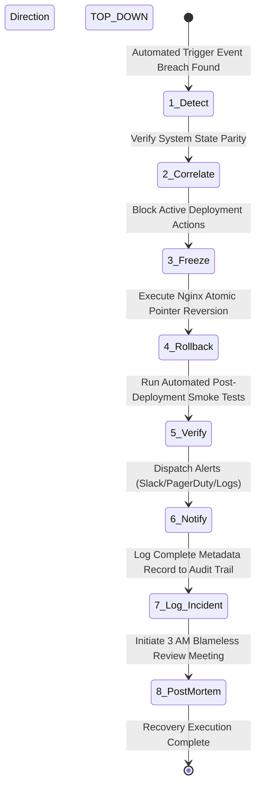

# NovaPay Digital Bank - Automated Rollback Trigger Taxonomy & Execution Engine

This document defines the automated error classification matrix, fallback rules, alert routing conditions, and execution recovery sequencing deployed to handle immediate service restoration with sub-60-second response latency.

---

## 1. Rollback Trigger Taxonomy Matrix

NovaPay classifies production performance degradation into three distinct structural operational bands:

| Trigger Classification | Criticality Horizon | Detection & Metric Source | Target SLA Threshold | Automated Recovery Execution Rule |
| :--- | :--- | :--- | :--- | :--- |
| **Category A: Immediate** | High Blast Radius System Failure | • Prometheus API Engine<br>• Docker Container Health Probes | • HTTP 5xx rate > 5% sustained for 60 seconds.<br>• 3 consecutive container liveness failures.<br>• Database connection pool saturation >= 98%. | **100% Zero Human Intervention.**<br>The Nginx traffic proxy pointer reverts instantly to the previous stable runtime target. |
| **Category B: Escalated** | Gradual Performance Degradation | • OpenTelemetry Tracing Logs<br>• Prometheus Resource Dashboards | • p99 latency > 2x the rolling historical baseline for 5 min.<br>• Error budget burn rate > 10x for 10 min.<br>• Transaction drop rate > 2%. | **PagerDuty Alert Dispatch.**<br>Escalates to the on-call SRE Engineer; triggers auto-rollback if no human override token is submitted within **15 minutes**. |
| **Category C: Manual** | Retroactive Failure Identification | • Visual Log Inspection<br>• Regulatory Compliance Alerts | • Customer support event logging.<br>• Downstream third-party payment gateway isolation.<br>• Security drift detection flag. | **Human Operator Decision Loop.**<br>Requires manual execution of the rollback pipeline following standard change management validation rules. |

---

## 2. Production Prometheus Alerting Rules Specification

To codify these thresholds inside your active observability layout stack, the following target rules are configured inside Alertmanager formats:

```yaml
groups:
  - name: novapay_production_rollback_alerts
    rules:
      # Category A Trigger: Immediate High Error Rate
      - alert: NovaPayHighHTTP5xxRate
        expr: (sum(rate(nginx_http_requests_total{status=~"5.."}[1m])) / sum(rate(nginx_http_requests_total[1m]))) * 100 > 5
        for: 60s
        labels:
          severity: critical
          category: A_immediate
        annotations:
          summary: "Catastrophic HTTP 5xx production error rate detected"
          description: "Production error rate is at {{ \$value }}%, bypassing standard human checkpoints."

      # Category B Trigger: Sustained Latency Saturation
      - alert: NovaPayP99LatencyBreach
        expr: histogram_quantile(0.99, sum(rate(http_request_duration_seconds_bucket[5m])) by (le)) > 0.400
        for: 5m
        labels:
          severity: warning
          category: B_escalated
        annotations:
          summary: "Production p99 transaction latency exceeding SLA limits"
          description: "Current p99 latency baseline has inflated to {{ \$value }}s over a 5-minute evaluation window."
```

---

## 3. The 8-Step Rollback Execution Sequence

When a Category A threshold is breached or a Category B timer expires without engineering intervention, the recovery framework processes operations via this deterministic path:



---

## 4. Regulatory Reference Mapping
* **RBI Master Direction Sec 4.2:** Mandates explicit, well-tested rollback procedures to prevent incomplete data states during release lifecycle anomalies.
* **RBI Master Direction Sec 6.3:** Enforces strict execution frameworks for automated disaster isolation and immediate operational system continuity protocols.
